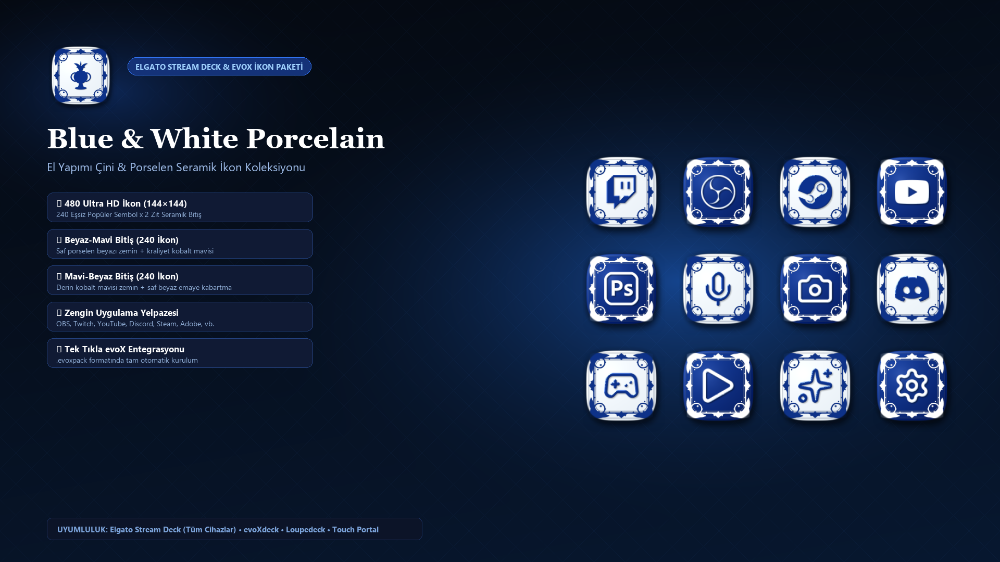

# 🏺 Blue & White Porcelain — Stream Deck Icon Pack

> **Pure Blue and White Ceramic Stream Deck Icon Suite (480 PNGs).** Featuring 240 hand-curated streaming, gaming, creator, and productivity symbols in two signature finishes: **Beyaz-Mavi (White-Blue)** and **Mavi-Beyaz (Blue-White)**. Pure cobalt glaze with zero red.

---

  
    
  

---

## 🌟 Two Signature Finishes

1. **⚪ Beyaz-Mavi (White & Blue - 240 Icons):** Crisp pure white porcelain base, ornate cobalt blue filigree border, and 3D embossed cobalt ceramic glyph.
2. **🔵 Mavi-Beyaz (Blue & White - 240 Icons):** Deep royal cobalt blue glazed base, pure white enamel filigree border, and 3D embossed white ceramic relief.

---

## 📂 Categories (240 Curated Symbols)

| Category | Count | Key Symbols Included |
| :--- | :---: | :--- |
| **Streaming & Audio** | 45 | OBS, Twitch, YouTube, Kick, Streamlabs, Mics, Cameras, Record, Play, Stop, Volume, Audio Waves, EQ |
| **Gaming & Esports** | 45 | Steam, Epic Games, Riot, Minecraft, Valorant, Apex, CS2, Fortnite, Roblox, Battlenet, Xbox, PS5 |
| **Creator & Design** | 40 | Photoshop (Ps), Premiere (Pr), After Effects (Ae), Illustrator (Ai), InDesign, Figma, Blender, Resolve |
| **AI, Dev & Tech** | 40 | ChatGPT, Claude, Notion, GitHub, Terminal, Python, VS Code, Docker, Apple, Windows, Linux, Android |
| **System & Workflow**| 40 | Home, Folders, Save, Trash, Settings, Sliders, Refresh, Download, Upload, Clipboard, Calendar, Power |
| **Social & Media** | 30 | Discord, Spotify, Twitter/X, Instagram, TikTok, Telegram, WhatsApp, Gmail, Soundcloud, Messages |

---

## 🚀 Quick Start

### Option A: 1-Click Import (.evoxpack)
1. Download **`Porcelain Icons.evoxpack`** from the [Latest Release](https://github.com/Hfatih/porcelain-icon-pack/releases/latest).
2. Double-click or open it inside the **evoX Stream Deck App** / Asset Manager.
3. The pack will automatically install and categorize all 480 icons.

### Option B: Direct PNG Usage in Elgato Stream Deck
1. Download the archive or clone this repository.
2. Open the **Elgato Stream Deck** software.
3. Drag any `.png` from `icons/` directly onto any Stream Deck key.

---

## 📜 License
MIT License. Free for personal streaming and commercial production setups.
