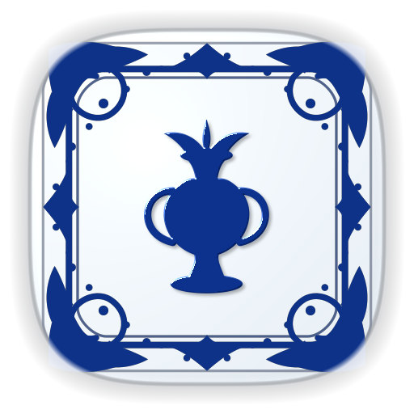

  
  <h1>Blue & White Porcelain</h1>
  
<strong>evoX ve Makro Tuş Takımları için 480 Adet El Yapımı İznik & Delft Çinisi Seramik Squircle İkonu (Beyaz-Mavi & Mavi-Beyaz).</strong>

  

    <strong>Dil / Language:</strong> <a href="README.md"><strong>EN</strong></a> | <a href="README.tr.md"><strong>TR</strong></a>
    &nbsp;•&nbsp;
    <a href="https://github.com/Hfatih/porcelain-icon-pack/releases/latest">.evoxpack İndir</a> ·
    <a href="https://hfatih.github.io/porcelain-icon-pack/">Canlı İnteraktif Galeri</a> ·
    <a href="#kurulum-rehberi">Nasıl Kurulur?</a>
  

  

    
    
    
    
    
    
  

  

    
    
    
    
    
  

---

  
  
<em>İki zıt bitişte 480 otantik çini seramik ikon: Saf porselen beyazı zemin + kobalt mavisi sır ve tam tersi kraliyet kobalt zemin + beyaz emaye kabartma.</em>

---

## Genel Bakış

**Blue & White Porcelain**, Osmanlı İznik çinilerinden ve tarihi Delftware porselen sanatından ilham alarak **evoXdeck**, **Makro Tuş Takımları**, **Loupedeck** ve **Touch Portal** cihazları için özel olarak tasarlanmış ultra lüks bir seramik ikon paketidir.

Her ikon, hassas süperelips ($p=3.75, r=120$) squircle tabanında $144\times 144$ doğal çözünürlükte modellenmiş; porselen sır parlaklığı, elle çizilmiş köşe filigranları ve gerçekçi 3D kabartma dokusuyla donatılmıştır.

### 🌐 Canlı İnteraktif Web Galerisi
Tüm 480 ikonu tarayıcınızda canlı olarak arayabilir, filtreleyebilir ve deneyimleyebilirsiniz:  
👉 **[GitHub Pages Üzerinde Canlı Galeriyi Aç](https://hfatih.github.io/porcelain-icon-pack/)**

---

## 🌟 İki Özel Seramik Bitiş (Her Biri 240 İkon)

| Bitiş Türü | Taban Seramik Malzemesi | Kenarlık Filigranı | 3D Kabartma İkon | Renk Paleti (Hex) |
| :--- | :--- | :--- | :--- | :--- |
| **⚪ Beyaz-Mavi** *(Fotoğraf 1 - Zıt)* | Saf parlak porselen beyazı, soğuk sır yansıması | Zengin kraliyet kobalt mavisi filigran | 3D sırlı kobalt mavisi seramik kabartma | `#ffffff` / `#0e3288` |
| **🔵 Mavi-Beyaz** *(Fotoğraf 2 - Klasik)* | Derin kraliyet kobalt mavisi sırlı seramik taban | Saf beyaz emaye köşe filigranı | 3D sırlı saf beyaz emaye kabartma | `#082470` / `#ffffff` |

> [!NOTE]
> Her iki bitiş de matematiksel olarak renk kalibrasyonundan geçirilmiş ve kırmızı/pas kanal tonları tamamen sıfırlanmıştır ($R < 15, B > 135$).

---

## 📂 Kategorilere Göre İkon Dağılımı (240 Sembol × 2 Bitiş = 480 İkon)

### 1. 📡 Yayıncılık ve Ses Kontrolleri (45 Sembol × 2 = 90 İkon)
- **Yayın Platformları:** OBS Studio, Twitch, YouTube, Kick Streaming, Streamlabs.
- **Mikrofon & Kamera:** Stüdyo Mikrofonu, Sessize Al (Mute), Vokal Mic, Kamera, Kamera Kapat, Video Kamera, Video Kapat, Webcam Aygıtı, Canlı Radyo, TV Ekranı.
- **Medya Oynatma:** Sahne Klaketi, Film Şeridi, Müzik Parçası, Plak Disk, Kulaklık, Ses Seviyesi (Düşük, Yüksek, Mute, Kapalı), Oynat, Duraklat, Durdur, İleri Sar, Geri Sar, Döngü (Loop), Karışık Çal, AirPlay/Cast, Ekran Paylaşımı, Ekran Önizleme.
- **Yayıncı Uyarıları:** Ses EQ Çizgileri, Ses Dalgası, Büyülü Parıltı, Yayın Sağlık Göstergesi, Bildirim Zili, Çalan Zil, Yayın Sohbeti, Destekçi Kalbi, Hype Treni Alevi, Rozet Ödülü, Şampiyonluk Kupası.

### 2. 🎮 Oyun ve Espor Dünyası (45 Sembol × 2 = 90 İkon)
- **Başlatıcılar:** Steam, Steam Deck, Epic Games, Riot Games, Battle.net, EA App, Ubisoft Connect, GOG Galaxy, PlayStation Network, Xbox Live, Nintendo Switch.
- **Popüler Oyunlar:** Minecraft, Valorant, Apex Legends, Counter-Strike 2, Fortnite, Roblox, PUBG, Dota 2, League of Legends, Cyberpunk 2077, Among Us.
- **Oyun Donanımı & Savaş:** Modern Gamepad, Retro Arcade Kolu, Çapraz Kılıçlar, Şövalye Kılıcı, Zırh Kalkanı, Kalkan Uyarısı, Onaylı Kalkan, Kral Tacı, Kurukafa, Bomba, Zarlar, Yıldırım (Zap), Değerli Mücevher, Hayalet, Nişangah (Crosshair), Joystick, Roket, Madalya, Pusula, Bayrak, Savaş Baltası, Kazma, Hedef Tahtası.

### 3. 🎨 Tasarım ve İçerik Üretimi (40 Sembol × 2 = 80 İkon)
- **Adobe Creative Cloud:** Photoshop, Premiere Pro, After Effects, Illustrator, InDesign, XD.
- **3D & Video:** Figma, Blender 3D, DaVinci Resolve.
- **Ses Prodüksiyon:** FL Studio, Audacity, Soundpad, VoiceMeeter Banana.
- **Tuval & Çizim Araçları:** Katmanlar (Layers), Kırpma (Crop), Renk Paleti, Fırça, Makas, Dolma Kalem, Efekt Parıltısı, Sihirli Değnek, Kontrast, Damlalık (Pipette), Sayfa Düzeni, Damga, Yakınlaştır, Uzaklaştır, Cetvel, Izgara, Tipografi, Şekiller, Silgi, Taşıma, Dönüştürme, Çevirme, Katman Kilitle, Dışa Aktar, Render.

### 4. ⚡ Yapay Zeka, Yazılım ve Araçlar (40 Sembol × 2 = 80 İkon)
- **Yapay Zeka & Notlar:** ChatGPT, Claude AI, Notion.
- **Geliştirici Araçları:** GitHub, Git Branch, Terminal CLI, Python, Visual Studio Code, Docker.
- **İşletim Sistemleri & Tarayıcılar:** Apple macOS, Windows 11, Linux, Android, Google Chrome, Mozilla Firefox, Brave, Microsoft Edge, Safari.
- **Bulut & Donanım:** Slack, Trello, Google Drive, SQL Veritabanı, Sunucu Kabini, Bulut Depolama, Bulut İndir, Bulut Yükle, Kod Etiketleri, Kod Ağacı, Hata Ayıklayıcı (Bug), CPU İşlemci, SSD Sabit Disk, Wi-Fi Açık, Wi-Fi Kapalı, Bluetooth, Pil Şarjı, Kilit, Açık Kilit, Anahtar.

### 5. ⚙️ Sistem ve Masaüstü Kısayolları (40 Sembol × 2 = 80 İkon)
- **Gezinme & Dosyalar:** Ana Sayfa, Arama, Klasör, Açık Klasör, Dosya, Metin Belgesi, Kaydet Disket, Çöp Kutusu.
- **Eylemler:** Ayarlar Dişlisi, Kaydırıcılar (Sliders), Yenile/Senkronize, Saat Yönünde Döndür, Tersine Döndür, İndir, Yükle, Pano (Clipboard), Onaylı Pano, Kopyala, Paylaş, Dış Bağlantı, Yer İmi.
- **Zaman & Yardımcılar:** Takvim, Günlük Takvim, Saat, Kronometre, Hesap Makinesi, Güç Kapat, Gece Modu Ay, Monitör Ekran, Mekanik Klavye, Fare İmleci, Yazıcı, Geri Al, İleri Al, Onay İşareti, Onay Rozeti, Kapat İptal, Hata Rozeti, Yardım SSS.

### 6. 💬 Sosyal Medya ve İletişim (30 Sembol × 2 = 60 İkon)
- **Sosyal Ağlar:** Discord, Spotify, Apple Music, SoundCloud, X (Twitter), Instagram, TikTok, Threads, Reddit.
- **Mesajlaşma:** Telegram, WhatsApp, E-posta Zarfı, Okunmuş Posta, Telefon Arama, Gelen Çağrı, Sohbet Balonu, Mesaj Gönder, Gelen Kutusu.
- **Topluluk:** Topluluk Üyeleri, Kullanıcı Profili, Takipçi Ekle, Bahsetme (@), Etiket (#), Doğrudan Link, Beğeni (Başparmak), Gülen Yüz, Favori Yıldız, Sabitlenmiş Mesaj, Harita Konumu, Dünya Web Küresi.

---

## 🚀 Kurulum Rehberi

### 1. evoX / evoXdeck (Önerilen — Tek Tıkla Kurulum)
1. [En Son Sürüm](https://github.com/Hfatih/porcelain-icon-pack/releases/latest) sayfasından **`Porcelain Icons.evoxpack`** paketini indirin.
2. **evoXdeck** uygulamasını açın.
3. İndirdiğiniz `.evoxpack` dosyasını uygulama penceresine sürükleyip bırakın veya Paket Yöneticisi üzerinden içe aktarın.
4. 480 ikonun tamamı anında kategorilerine göre düzenlenmiş olarak Stream Deck panelinize yüklenecektir!

### 2. Makro Tuş Takımları
1. Depodaki veya yayın arşivindeki **`icons/`** klasörünü bilgisayarınıza indirin.
2. Deck / makro tuş takımı yazılımınızda istediğiniz tuşa tıklayın.
3. `Beyaz-Mavi` veya `Mavi-Beyaz` klasöründeki istediğiniz 144×144 PNG ikonunu tuş yuvasına sürükleyip bırakın.

### 3. Loupedeck & Touch Portal
1. `icons/` klasörünü açın.
2. Loupedeck veya Touch Portal yazılımında tuş özelleştirme alanından ilgili ikonu seçerek atayın.

---

## 📐 Teknik Özellikler

| Özellik | Değer |
| :--- | :--- |
| **Doğal Çözünürlük** | $144\times 144$ Piksel (Makro Deck 144x144 doğal ızgara standardı) |
| **Süper Örnekleme** | $288\times 288$ Alt piksel modelleme, Lanczos/Area ile 144px indirgeme |
| **Karo Geometrisi** | $p = 3.75$ Hassas squircle süperelips |
| **Renk Derinliği** | 32-bit RGBA PNG, pürüzsüz alfa saydamlık |
| **Paket Formatı** | `.evoxpack` arşivi + bağımsız PNG ikonları |
| **Tasarımcı & Geliştirici** | [Hfatih](https://github.com/Hfatih) |
| **Lisans** | [MIT Lisansı](LICENSE) (Kişisel ve ticari yayınlarda tamamen ücretsiz) |

---

  
💙 <a href="https://github.com/Hfatih">Hfatih</a> tarafından tasarlandı ve geliştirildi.

